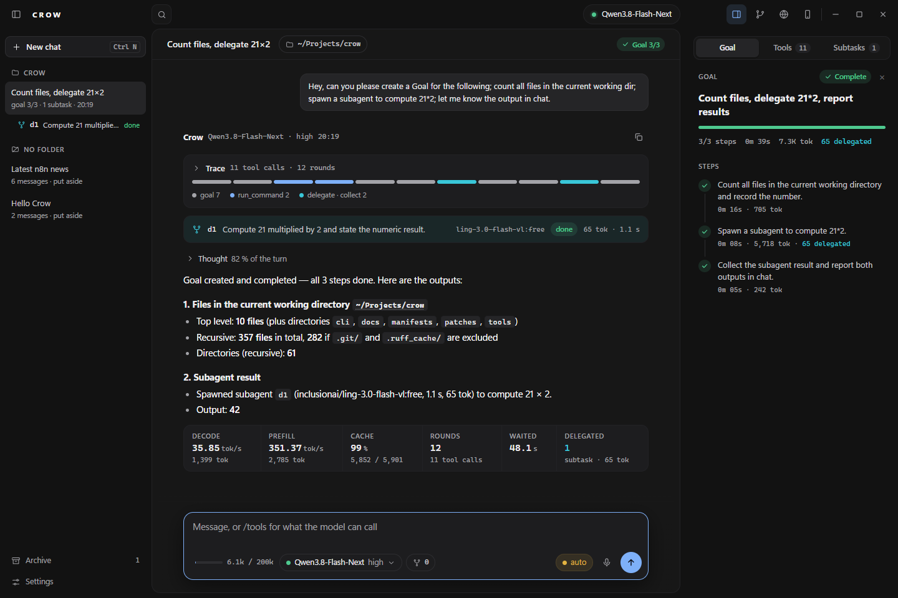

[← README](../../README.md) · [Docs index](../README.md)

# Goals and subagents

Two mechanisms that turn a chat into a piece of work: a **goal** is the plan the model writes for
itself and works through step by step, and a **subagent** is a task it hands to a second model
while it keeps going.

---

## Goals (#161–#165)

| | |
|---|---|
| Tools | `goal_set(title, steps)` writes the plan, `goal_step(step, status, note)` moves one step |
| From the composer | `/goal <title>` then one step per line, or `title \| step \| step`. A line `check: <command>` (or a `\| check: <command>` part) is the acceptance check, not a step (#250). A line `accept: <item>, <item>` is the judge's checklist for every visual step, and `accept: 5: <item>` binds it to step 5 (#266, #295). A line `reference: <image> -- <criterion>` gives the judge a reference image (#295). Neither is a step. `/goal` alone shows where it stands, `/goal skip <n> [reason]` skips step n (#289), `/goal redo <n>` takes that skip back (#296), `/goal off` clears it and its check |
| Goal tab | the first tab of the inspector beside the chat, selected when a new goal is set unless you picked another tab in that chat: a status pill, the title, a progress bar, `done/total` steps, wall clock, tokens, delegated tokens, and one row per step on a timeline (#384). The chat head's `Goal 3/3` pill opens it ([window](window.md)) |
| Store | `<root>/.crow/goal.json`, beside `MEMORY.md` — the goal belongs to the folder the work is in |
| States | `open` · `running` · `done` · `failed` · `skipped` (#289, only by you). The goal can be `paused` (#294), and it ends `done`, or "complete with N skipped" when you skipped a step |
| Talking to it | a line typed while a goal turn runs is queued and runs **before** the next nudge, resetting the turn caps (#264). **Stop pauses the goal**: the turn ends, no next turn starts, a note says so, and the next line you send resumes it (#282). Escape = Stop |
| Limits | 60 turns for the whole goal, 25 turns and 60 min of active wall clock for one step, 10 nudges without a newly passed checklist item, a brake on three identical or three empty answers, and the same failure class three times in one step named in the next nudge (#165, #202, #294). Every cap pauses the goal with a report; none of them skips |
| `done` | refused when its note says the step is not done, and — with a `check:` set — refused on the step that would close the goal until the check exits 0 (#250); on a visual step, refused without a capture from this goal in the note or under the judge's bar (#267) |

**Two tools and not one, because they cost different things.** The plan goes into the pinned head
of every prompt, so writing one costs a full prefill — the composer says so before it changes
anything. Ticking a step off writes only the file, so it costs nothing and does not move byte 0.
The head carries the **plan**; the file carries the **state**. Five steps in the head would have
been five full prefills.

**It outlives the context.** The head block ends with a sentence saying so, and it is true: a goal
survives a rollover, a restart, and a window that is opened a day later on the same folder. A new
session that finds an active goal says which one it is and how far it got, instead of leaving it
invisible until somebody asks. At a rollover the head is re-pinned anyway, so that one head carries
the marks — each step `[done]`, `[failed]`, `[skipped]`, `[running]` or `[open]`, plus the next open step — as
they stood at the cut; they are not refreshed afterwards (#210).

**One step runs at a time.** The local server has one slot (`-np 1`), so a store that allowed two
`running` steps would describe a machine that does not exist.

### A failure has a class and a ladder, and the end of every ladder is a pause (#294)

Seen on 2026-09-24/25: the diorama goal ended "complete with 4 skipped". Steps 5–8 were skipped by
the engine after two `failed` each (#289's rule), each judged on a software-GL capture, and nobody
was asked. Since #294 the engine never skips a step. Only you do, with `/goal skip <n>`.

| Class | What counts | What happens |
|---|---|---|
| **environment** | the render says `render_mode` `unavailable`, or `software` on a GPU step (WebGL, shaders, 3D, voxels, ray tracing, diorama, three.js); the judge's precheck finds the frame uniform, near-black or under 16 colours; the frames are identical on a step that needs motion; no judge answered | the next turn waits 15 s and asks for a new render; after **2** retries the goal **pauses**. The same capture, or a second failure before the retry went out, counts once |
| **capability** | a valid capture the judge does not pass (a must-item "no"), or `failed` on valid evidence | attempt 2 after a written **reflection** on the judge's feedback (`goal_step(n, "running", note="reflection: …")`); attempt 3 in a **fresh context** (the #268 rollover, carrying the failures and the reflections); then the step is **split** into 2–3 sub-steps (`goal_step(n, "split", substeps=[…])`, ADaPT), reported with `goal_step(n, …, sub=k)`; a failed sub-step, or a miss after all of them are done, **pauses** |
| **unknown** | the judge answers "unknown" on a must-item | once: make the capture show it; twice on the same step: **pause** |

A rung is climbed once per attempt: three judge calls in one turn are one attempt, not three.

**A pause asks you.** The goal's state becomes `paused` (`pause` in goal.json: step, class, why)
and the step's clock stops. Crow gives the model **one** more turn with no tools, to write for you
what it identified, why it cannot proceed, 2–3 concrete proposals, and whether you have further
input. The report appears in the chat, in the window and on the phone. It is also kept as
`pause.report`. The Goal tab's pill reads **Paused · step N**, and a line under the title gives the
reason. After that the engine waits. **Only a typed line resumes**, from the window or the phone.
It starts the step's counters and its budget over. `/goal` alone does not resume. The turn caps
(25 per step, 60 per goal) pause the same way, and so do the two budgets:

| Budget | Default | Setting / environment |
|---|---|---|
| active wall clock per step, since the last resume | 60 min | `goal_step_minutes` / `CROW_GOAL_STEP_MINUTES` |
| nudges on a step with a checklist and no item newly passed | 10 | `goal_no_progress_turns` / `CROW_GOAL_NO_PROGRESS_TURNS` |

| | |
|---|---|
| `/goal skip <n> [reason]` | you skip step n: window, terminal and phone. The reason becomes the step's note (default: "skipped by the user"). A `done` step cannot be skipped. There is no `/goal done <n>`: acceptance stays with the evidence gates below |
| `/goal redo <n>` | takes your skip back: the step is `open` again (#296). The model cannot do this: its `done` or `running` on a step you skipped is refused |
| `skipped` | counts as not done. The engine moves past it. The goal ends "complete with N skipped", never `done`, and an acceptance check does not run for it. A step stored `done` whose note starts with "skipped" (the 2026-09-24 hand edit) is read as skipped (#296) |
| Goal tab | a skipped step has its own colour (violet `--skip`), a dashed ring with a skip glyph, and the word "skipped". The running step has an accent ring, and the paused step shows a red pause glyph and the word "paused" (#384). The status pill says `Open · step 4 skipped`, `Complete · step 4 skipped` at the end, or `Paused · step N`. A split step lists its sub-steps under it |

Not measured live: whether the pause reports read well, and how often a local model recovers on
the reflection and split rungs.

**The Goal tab follows goal.json, not only the goal tools (#289).** Every round, before every turn and
on `/goal`, Crow reads the file and redraws the tab when a step or the goal changed state. A hand
edit of `goal.json` shows up at the latest after the current round. Before, only `goal_set` and
`goal_step` redrew it during a turn, so a hand edit stayed hidden until the next turn ended.

**`done` means verified working (#250).** Seen live on 2026-09-23: a goal closed at 9/9 over a
page that drew nothing, with step notes such as "treated as done-with-deviation only in spirit".
Two guards now stand in front of `goal_step(..., "done")`:

- *The note is read.* A `done` whose own note reports failure — "in spirit", "with deviation",
  "not done", "cannot be created", "unreachable" and similar — is refused with the words that
  tripped it, and the model is told to finish the step or report it `failed`. A `done` with no note
  on a step last reported `failed` is refused too: it has to say what proves it works now. Replayed
  on the 10 real `done` calls of 2026-09-23: 6 refused, the 4 with positive notes pass.
- *The user's acceptance check.* `/goal title | step | step | check: <command>` stores a command.
  The `done` that would close the goal — every other step already `done` — runs it through
  `run_command`, with its clock, capture cap and (on Linux) memory scope. A non-zero exit refuses
  the `done`, the result carries the command's output, and the goal stays open. The head names the
  check. It is stored in the session directory (`goal-checks.json`, keyed by the goal's path), not
  in `goal.json`: the working area is writable by the model, and a command it wrote there would run
  unasked at `allowedit`. A replan by the model keeps the check; `/goal off` drops it. Only the
  user sets one — the model's `goal_set` has no such field.

Not measured: whether the model then finishes the work instead of stopping at the refusal.

**A visual step is done on a picture (#267).** Seen on 2026-09-23: 9/9 `done`, step 8's note
"Every criterion reads 9+ on the capture", and the capture it named was a small purple box in a
black frame. The two guards above passed all nine final notes. On a **visual goal** — its title or
steps name visual work (render, screenshot, html, css, canvas, webgl, scene, diorama, voxel, 3d,
shader, svg, ui, …), or `goal.json` says `"visual": true` (`false` switches it off) — a `done`
also needs:

- *A capture from this goal in the note.* A path to a `.png`/`.jpg`/`.webp` that exists and was
  written after the goal was created. A bare name such as `render-20260923-232855.png` is looked up
  in `.crow/renders/`. A step that only plans is exempt: its leading phrase (before the first `:`,
  `,` or `(`) starts with think/plan/research/read/outline, and it names no making verb (build,
  implement, render, draw, code, write the page). "verify"/"fix" later in such a step count as
  planning when it writes a document (`.md`, plan, notes, report), so "Think and plan: …, verify
  findings, write PLAN.md" is exempt and "Verify offline via file://, fix, report fps" is not.
  The refusal says so.
- *The judge's checklist* (#295). Each visual step gets a checklist that is frozen when the step
  starts. It comes from your `accept:` lines (`accept: 5: puddles reflect the neon` binds to step 5),
  else from the model, which writes it once with `goal_step(n, "running", checklist=[…])`, else from
  the first `judge` call. The [judge](../reference/tools.md#judge-266-295) answers each item yes/no/unknown
  on the render's clock-stepped frames or contact sheet when there are any. `done` needs every
  must-item "yes" (`optional:` items do not gate), and a step with a checklist needs a verdict at
  all. A capture that is software-rendered on a GPU step, blank, black or frozen on a motion step
  never reaches the judge model: it is an environment failure (above). A verdict stored before the
  checklist existed is still held to `judge_threshold` (default 8, `settings.json` or
  `--judge-threshold N`).
- *Reference images* (#295). `reference: <image> -- <criterion>` in `/goal` (at most 2) sends your
  image after the capture and adds the item "as good as the reference image on: <criterion>". The
  path is yours, stored in the session directory. For the diorama, for example:
  `reference: ~/Projects/localconf/testcases/diorama-check/reference/screenshot-2026-09-21_13-59-31.png -- voxel detail`.
  These items are advisory (they never gate) until the judge is calibrated against your own
  good/bad labels.

The refusal says what is missing and how to get it: `render_page`, `read_image`, `judge`, and the
path in the note, or `failed` with a reason when nothing can be rendered. The step nudge says the
same thing when it hands out a visual step, so the first refusal is not the first time the model
hears the rule. The goal from 2026-09-23, with its final notes replayed: before 9/9 accepted, after
6 refused (steps 2–6 with no note, and step 9 with no capture). Step 1 is exempt as planning.
Steps 7–8 cite real captures and are held by the judge's score. Goals without visual work are
unchanged.

**Crow's nudges are not your words (#240).** Goal-mode nudges travel as user-role messages and
carry the model's own plan text. The paths in them used to count as user-named, which released the
outside-path question (#144) for places only the model had named. Now only a plan you typed with
`/goal` counts as yours (`by` in `goal.json`); a plan the model wrote with `goal_set` does not.

**A goal that has stopped getting anywhere is stopped, and says so.** Seen live on 2026-09-18:
thirty-five answers of a single character in a row, at 130,939 tokens, each one answering the same
nudge. Four things catch that now (#202).

*The brake.* Three identical answers — same text and the same tool calls with the same arguments
— or three empty ones, where empty means at most two characters and no tool call at all, are read
as a loop rather than as progress. Those turns are then **taken out of the history**, nudge and
answer together, and one recovery line goes out in their place naming the step that is still open.
How many messages were taken out is written to Crow's log file (`~/.local/state/crow/log/crow.log`,
see [the window](window.md), *Crow log*), not into the flow.
An empty answer to that line ends the goal, with a line in the flow saying how many times, at what
context size, and how many of how many steps are done. There is no second recovery line. Removing
the loop is the point: an empty answer left standing in the history is an example the next turn
copies.

*A reply that is not an answer is not stored (#217).* Bare tool-call markup
(`<tool_call></function></tool_call>`) or a stub (`Let me stop re-`, an announcement ending
on a colon with no call behind it) used to end the turn, stay in the history and open the next
nudge — five markup rounds and one stub in 42 minutes on 2026-09-22, the markup copied four
times. Such a round is now dropped and asked again once in the same turn, with a new seed and
no nudge. A stub again on the retry is kept as the answer (a short answer like `Erledigt` is
never refused twice); markup again ends the turn with one red line. See
[Rounds that are not answers](../reference/tools.md#rounds-that-are-not-answers-217).

*A cap on one step: 25 turns*, beside the 60 the whole goal gets. The counter belongs to the step,
so it starts again at every step and a plan that is moving never meets it. A step that has taken 25
turns is either cut wrong or not doable, and both are questions for you: the goal pauses, `/goal`
shows where it stands, and typing a line carries on from there.

*A shorter nudge.* The first turn of a step gets the whole instruction, because that is where the
step is named. From the second turn on, if the last turn worked on the nudge and called a tool, it
gets `[Goal mode, step N still open. Continue.]` instead. The full block repeated byte for byte in
front of every turn is itself a pattern, and a model that reads a hundred copies of it continues
the pattern rather than the work.

*The same failure, named.* The brake watches the answers; a model that is busy — a tool call every
turn, no two answers alike — slips past it while hitting the same wall for hours. Seen live on
2026-09-22: three `web_search` calls with three different questions, all `HTTP 401` from the search
provider; 22 `edit_file` calls, none of which landed; six paths the model had never created;
`render_page` failing while the model raised `wait_ms` from 6000 to 20000. So Crow also sorts every
**failed** tool result of the running step into a class:

| Class | What counts | The line in the next nudge says |
|---|---|---|
| dead service | the same `HTTP 401/402/403` from the same tool and host (`collect` counts as `delegate`) | the tool is dead this session, stop calling it — work from local sources, ask for a key, or do the delegated work yourself |
| refusal loop | the same tool refusing with the same text, paths and numbers ignored | the refusal, and to do what it names before calling again |
| phantom path | "no such file" on a path that appears for the first time in the very call that fails (or already failed that way) | the paths — create them first, or use the files that exist |
| timeout | `render_page` capturing nothing, or a tool that timed out | a larger `wait_ms` will not help — lower it or make the scene cheaper, and do not drive a browser through `run_command` |
| same error | the same exception signature from `run_command` (`SyntaxError: …`, esbuild's `✘ [ERROR] …`), line numbers ignored | the approach is wrong, not the detail |

Only failures count: a result that starts with `error:` or a command with a non-zero exit, and for
a command only when a signature can be read — a `grep` that found nothing is not an error. At
**three** of one class in one step (the brake's number, and the one OpenHands, Aider and SWE-agent
settled on), the next nudge carries one line per tripped class — class, count, the way around —
**instead of** the step text, and a line naming class and count goes to `crow.log` (not into the
flow; the nudge itself is what the model reads). The line comes back only when that class
came back; a model that stopped is not told again. The counts belong to the step: they start over
when the step changes, when the model marks it `done`, and when you type a line. A step marked
`failed` keeps them, because Crow nudges that same step again. Counting happens between turns, so
a single turn can still spend its 24 tool rounds on the wall before the line arrives.

*The same picture, again (#268).* A debug loop can fail nothing and still go nowhere. Seen on
2026-09-23, 22:30–22:48: seven captures of `chain.html` in a row at 99.2–99.4 % one colour (a
black frame with an fps line), with an edit to another pass before each one. Every turn called
tools and no result was an error, so neither mechanism above fired. Crow therefore also counts,
per page, the `render_page` captures that came back **stuck**. A capture is stuck when it carries
a blank verdict (#213 blank or almost one colour, #175 byte-identical, "only N distinct colours"
from the pixel metrics), when its decoded frame is at least 98 % one colour, or when it nearly
matches the previous capture of the same page. "Nearly matches" uses the `metrics:` numbers
within 3 % (or ±2) when the render wrote them. Without them it uses the dominant-colour share
within 0.005 and the size within 3 %. A page never captured before in the step counts as a changed
approach and starts at zero.

| Stuck captures of one page | What happens |
|---|---|
| 3 | one nudge: *stop editing — bisect: render a minimal probe (the clear colour only, then one lit cube), then re-enable the passes one by one and render after each* |
| 6 | a forced rollover, even below the threshold. The line it carries lists each stuck capture with its verdict and the files written before it ("render-….png: 99.4 % one colour after writing src/03.js"). One per step; after that, the nudge again every third capture |

The count belongs to the step and is cleared by `goal_step … done`, like the failure classes. The
flow shows a note each time. It is replayed on the four session files of 2026-09-23: nudges before
messages 35 and 295 (rollover-210418, `index.html`, three near-identical and then three black
captures) and 314 (rollover-225111, `chain.html`, the 22:30 streak). No forced roll: each time the
model moved to another page (`verify-trace.html`, `probe.html`) before a sixth capture.

*No picture at all (#277).* On 2026-09-24 step 2 ran more than 1.5 h with 9 near-black captures of
`index.html` and the breaker above never fired. The frames showed a small lit patch on black: 91–96 %
one colour, so under the 98 % line, and their coverage kept changing (7 → 40 → 25 %), so no two
"nearly matched". A capture is therefore also stuck when its `metrics:` line says **luma mean 4/255
or less** (decoded from the PNG when the line is missing). Measured that day: the black frames at
0–2, the one real scene at 31, white text pages at 251–255 (a white page is a page, not "no picture").
Three more changes to the counting:

- The captures are counted every turn, also when a same-failure nudge speaks first. That turn's
  three black captures had been skipped.
- A turn cut by a rollover in the middle is still counted: the new context starts with the rollover
  note, so Crow scans everything after it (the carried tail of the turn).
- The same PNG is counted once. A repeated call answered from the first result and a result
  carried across the cut are not new captures.

When the last capture shows no picture, the nudge and the rollover line say "showed no picture"
and the bisect is concrete: *render ONE pass in isolation straight to the screen — the albedo/base
colour only, no lighting; then the normals as colour; then the depth. After each draw check
`gl.getError()` and `gl.checkFramebufferStatus()`, read a few pixels back with `gl.readPixels`, and
log those values to the console.* It names checks, not code. The thresholds (nudge at 3, roll at 6)
are unchanged. Replayed on 2026-09-24's two session files: the nudge before session message 13 (the
first nudge after the 10:50 rollover, 3 black captures), the forced roll before message 155 (9).

**The counters are the goal's, not the steps' sum.** Wall clock runs from the first step that
started, and tokens are what the goal cost across every context it lived in — thinking, tool
calls and the rollover itself included. Reading the step column instead inherited every error in
it and left out everything that happened between two steps (#174). `0` tokens means nobody has
reported a context size yet, and the column stays empty rather than wrong.

**A goal belongs to its folder.** Seen live on 2026-08-31: with the goal in one global place, a
second window started working a plan that had been set in another one — two windows working the
same plan twice, in a folder only one of them had bound. Two windows on the **same** folder still
share it, which is right: the same working area is the same work. Changing the folder while a
goal runs changes the goal with it; the old one is still where it was set, and comes back with
the folder. A chat with no folder at all keeps its goal in the session directory.

A goal with no steps is refused rather than created — the counter would read `0/0` and the header
would carry a heading with nothing hanging off it.

A plan that arrives as a **string** rather than a list is parsed once, or refused with an error the
model can act on — never walked character by character. Seen live on 2026-09-18, before the guard:
one over-packed JSON argument became 852 steps of one character each, and the panel read `0/852`.

---

## Subagents (#143)

`delegate` hands one task to a **separate model** and returns at once with an id. The work runs
beside the conversation; the turn keeps going.

| | |
|---|---|
| `delegate(task, context)` | starts the subtask, returns `d1` immediately |
| `subtasks()` | where every subtask of this session stands: running or finished, seconds, tokens. Costs nothing, waits for nothing |
| `collect(id)` · `collect("all")` | blocks until they finish and returns the results |
| From the composer | `/delegate <task>`, `/subtasks` — both pass the Stop gate, so they work **while a turn is running** |

**Never on this machine.** The local slot is refused as a delegation target, hard: parallelism is
bought at a provider, not from the card — one slot with a warm cache is exactly the thing a second
session would ruin. The spot is `providers.json`'s `delegate` block; with nothing set it is the
free pool's best answer, because nothing may be billed without a word. Three
[delegate favourites](remote-models.md) are tried in the order a person put them in, and a spot
that failed this session is skipped.

**When a spot fails, the error decides what happens next.**

| The spot answered | Meaning | The chain |
|---|---|---|
| 429, 408, 5xx, a timeout, "provider returned error", an empty reply | this spot is sick right now | next spot; at most three sick spots |
| 403 (a model gated to agentic harnesses, a moderation flag), "no endpoints found", a retired free slug's 404 ("unavailable for free", #284), 402 on a **paid** favourite | this spot will not serve this client | next spot; up to six refusals, not counted against the three |
| 401, 402 on a **free** spot (the account is below zero), a schema error | the key, the account or the request is wrong | stops. Every spot would answer the same way |

A spot that failed is skipped for the rest of the session, with its reason. A spot that hit a stop
error is not, because the spot was never the problem. The chain still falls forward only to
favourites and free models, so a fallback never lands on something that bills unless you chose it.
The card and the `collect` result name every spot tried and why each one failed:
`no spot answered -- tried a:free (HTTP 429: …); b:free (gated for this client (403): …)`.
A result that came from a fallback carries the same `fell back from …` note. The attempts are
also stored in `session/subtasks-registry.json` (`chain`) and in the subtask's transcript, so the
first spot's error is still there after a restart.

**A subtask sees nothing.** No conversation, no tools, no follow-up questions: text in, text out.
Everything it needs goes into `task` and `context`. That is a decided scope, not a missing
feature — research over its own knowledge, summarising, drafting, judging.

**Fan out first, collect once.** The parallelism lives *between* the two calls. Delegating and
collecting in turn waits exactly as long as doing the work would have.

| | |
|---|---|
| Running at once | 16. Delegating a seventeenth says to collect first |
| One subtask | 600 s, then it ends itself |
| `collect` | waits 600 s, then says so and leaves the subtasks running — call it again |
| Output cap | `subtask_max_tokens` in `settings.json`, default 8,192 |
| Tokens | counted from the remote's `usage` block — remote endpoints send no llama timings |
| Stop | cancels the local turn **and** the subtasks; whatever a stream still delivers is dropped and the card ends `interrupted` |

**In the window.** A subtask is a card in the inspector's **Subtasks** tab — id, state, time and
tokens, the task, the model and the result; running cards on top (#384) — a one-line card in the
flow where `delegate` was called, with id, task, model, state and `tok · s` (#383), and a child row
under its root chat in the rail, marked with a fork. Clicking the flow card or the rail row opens
the Subtasks tab with the card in view; a subtask is never opened as a chat. Cards keep breathing outside a turn, and they come back after a restart from
`session/subtasks-registry.json`: a `running` one becomes `interrupted`, the numbering continues,
and deleting a chat deletes its subtasks.

### `/verify` (#149)

The maker is not the checker. `/verify` assembles what this conversation wrote — `write_file`
whole, `edit_file` as replaced/with, reads deliberately absent — and delegates it to the spot with
review instructions; the verdict comes back as a subtask card. It is user-triggered on purpose: a
maker that may skip its own checker will.

---

## Related

| | |
|---|---|
| [Tools](../reference/tools.md) | every built-in tool, with the delegation section in full |
| [Window](window.md) | the Goal and Subtasks tabs these two draw into |
| [Remote models](remote-models.md) | the spot a subtask runs on, and how it is chosen |
| [Settings](../reference/settings.md) | `subtask_max_tokens`, `turn_token_budget` |
