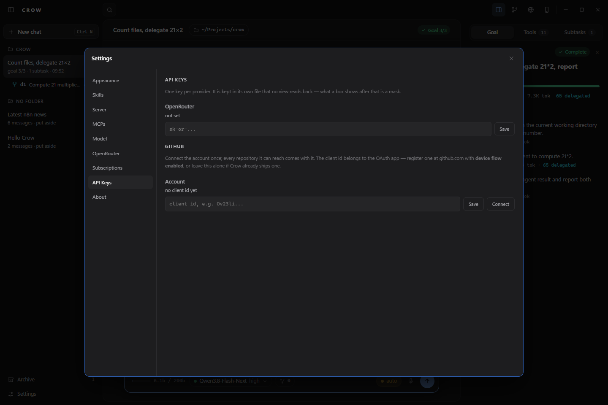
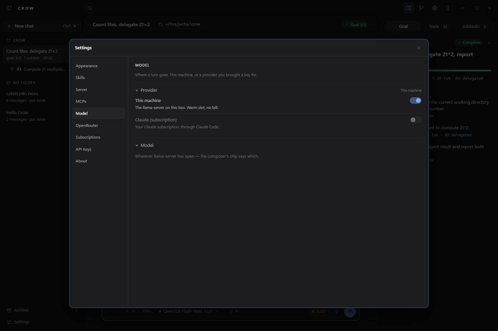

[← README](../../README.md) · [Docs index](../README.md)

# Remote models

`Settings → API Keys`, paste the key, then `Settings → Model`. The catalogue is fetched when the key
lands and on `ask again`. Nothing is asked of a provider while a window opens.

<div align="center">

</div>

<div align="center">

</div>

A key is kept in its own file that no view reads back — what the box shows afterwards is a mask.

OpenRouter has its own page instead: switch, delegate favourites and model pick. **The page routes
no turn** — its switch runs the broker for delegation while the machine keeps answering, in
parallel. The default is always the machine; turns leave it only through the Model page.

When a delegate spot fails, the error decides the next step: a sick spot (429, 5xx, timeout) and a
spot that will not serve this client (403, "no endpoints found", 402 on a paid favourite) are
skipped for the next one; 401, 402 on a free spot and schema errors stop the chain at once. The
result names every spot tried and why (#216). Full table:
[goals and subagents](goals-and-subagents.md#subagents-143).

Three files, in `%LOCALAPPDATA%\Crow\` on Windows and `~/.config/crow/` on Linux:

| file | |
|---|---|
| `providers.json` | active provider, model per provider, catalogue, favourites, the broker switch |
| `provider_keys.json` | keys, `0600`, read by no view |

| provider | endpoint | credential |
|---|---|---|
| This machine | `--base-url`, default `http://127.0.0.1:8083/v1` since 2.0.0 | none |
| OpenRouter | `https://openrouter.ai/api/v1` | `sk-or-...` |
| Claude (subscription) | Claude Code, one `claude -p` per turn | none in Crow: `claude auth login` |

| | |
|---|---|
| Typed slug | field beside `ask for the list`, sent exactly as entered |
| Variant suffix | `:free`, `:extended`, `:nitro`, `:floor` are part of the slug. `z-ai/glm-5.2` and `z-ai/glm-5.2:free` are two entries with two bills |

## Claude subscription

Anthropic's terms ([Legal and compliance](https://code.claude.com/docs/en/legal-and-compliance),
"Authentication and credential use", read 2026-10-15) do not let a third-party program route
requests through Free, Pro or Max credentials, or collect, store or intermediate them. What they
allow is signing in to the unmodified Claude Code program with your own subscription. So Crow
starts Claude Code and reads what it prints; it never sees, keeps or refreshes a token (#390).
The setup-token paste, the borrowed `~/.claude/.credentials.json` sign-in and Crow's own browser
sign-in are gone, and so are the Anthropic and OpenAI key providers with their own Messages dialect; OpenAI comes back in its own ticket. A `provider_tokens.json` left from them is
deleted on the next start, with one log line.

```bash
claude auth login
```

| | |
|---|---|
| Sign in | in a terminal, the command above (Anthropic's own flow); `Settings → Subscriptions` → `ask again`. Sign out: `claude auth logout` |
| From the operating-point window | pick **Claude (subscription)**: **Start** opens Crow on it without a local model, and a point can still be started there later. Not signed in, **Sign in** opens a terminal running `claude auth login`, and the entry turns to **Start** by itself once you are signed in ([boot](boot.md#operating-point-window)) |
| Tile | the Claude Code version, what `claude auth status` says (`signed in with your subscription`, a token from the environment, or `Claude Code bills an API key, not your subscription`), the guard variables that are set. Asked when the page opens and on `ask again`, not at window start |
| Pick | `Settings → Model` → Claude (subscription), then the model on the composer's chip |
| Needs | Claude Code on `PATH` (`npm install -g @anthropic-ai/claude-code` otherwise) and a chat with a folder: Claude Code works in it. A chat under No folder is refused with a sentence |
| A turn | `claude -p --output-format stream-json --verbose --include-partial-messages --model <m> [--effort <e>] --permission-mode <p> [--resume <id>]`, the line on stdin, the chat's folder as working directory, Crow's environment unchanged |
| Session | the `session_id` Claude Code reports is kept in the chat's session file; the next line of that chat runs with `--resume`, a new chat starts a new session |
| Stop | kills the child |

**Refused, nothing started**, while any of these is set in Crow's environment:
`ANTHROPIC_API_KEY`, `ANTHROPIC_AUTH_TOKEN`, `ANTHROPIC_BASE_URL`, `CLAUDE_CODE_USE_BEDROCK`,
`CLAUDE_CODE_USE_VERTEX`. Under `claude -p` an API key "is always used when present"
([troubleshooting](https://code.claude.com/docs/en/troubleshoot-install)), so the bill would move to
the key without a word. The sentence names the variable; Crow does not unset it for you.

| release level | `--permission-mode` |
|---|---|
| `manual` | `default` — with nobody to answer a prompt under `-p`, a tool that needs one is denied |
| `allowedit` | `acceptEdits` |
| `auto` | `auto` |
| `yolo` | `bypassPermissions` |

| composer chip | |
|---|---|
| Models | Fable 5.1, Opus 5.5, Sonnet 5.5, Haiku 5.5 (`--model fable/opus/sonnet/haiku`); `/model <id>` sends a full id. A model the installed Claude Code is too old for is greyed out with `claude update` (the docs: Opus 5.5 ≥ 2.1.280, Sonnet 5.5 ≥ 2.1.284, Haiku 5.5 ≥ 2.1.293). The chip names the model Claude Code reports, not the alias |
| Levels | `low` … `max` per model ([model config](https://code.claude.com/docs/en/model-config)); `(default)` sends no `--effort`, so the model's own default applies (`medium` on the 5.5 models). While `CLAUDE_CODE_EFFORT_LEVEL` is set the menu is off and names it: that variable outranks `--effort` |
| Context | the last request's input, cache-read and cache-write tokens over the window Claude Code reports (`modelUsage.contextWindow`) |

**What changes against the other providers.** Claude Code runs its own tools (Bash, Read, Edit,
Write, Grep, web, subagents) and loads your own Claude Code setup: `CLAUDE.md`, hooks, skills, MCP
servers. Crow's tools are not offered: no image generation or editing, no goals (an open goal is not
nudged on this provider, since nothing could close a step), no `session_search`, `judge` or
`render_page`. For those, use the local model. Crow's rollover, tool-result clearing and background
review do not run; Claude Code compacts its own session.

| measured 2026-10-15, Windows 11, Claude Code 2.1.300, Max plan, `--model haiku`, owner's Claude Code setup | |
|---|---|
| first turn, one Bash call | 10.9 and 12.4 s (two runs) |
| second turn, `--resume`, same session id | 4.8 and 5.6 s; it named the first turn's command |
| context after the first turn | 42,058 and 42,073 tokens of 1,000,000 — most of it Claude Code's prompt and the owner's setup |
| not measured | quota per turn (Hermes' docs say about 1.7× the interactive TUI), Stop mid-turn, `--effort` against the real CLI, the window live |

## One dialect

| transport | endpoint | who |
|---|---|---|
| `chat_completions` | `<base>/chat/completions` | the local server, OpenRouter |
| `claude_cli` | none: a `claude -p` child | Claude (subscription) |

Anthropic's native `/v1/messages` dialect went with the `anthropic` provider (#390, 2026-10-15).

## One answer's ceiling

`max_tokens` travels on a remote request and not on a local one. Measured 2026-08-23, without it
OpenRouter answered:

```
HTTP 402 -- you requested up to 65536 tokens, but can only afford 313
```

A provider reserves and prices the model's maximum output when the body names no cap. llama-server
reserves nothing and bills nobody, and a cap there would cut long answers it is happy to finish.

## Which upstream answers

OpenRouter is a broker: one slug is served by many upstream companies. One field is sent to it and
to nobody else.

| field | | |
|---|---|---|
| `session_id` | sticky routing key | all turns of one chat go to the same upstream |

| | |
|---|---|
| Value | sha256 of the chat's path, never the path. That path names a person and a directory layout |
| Length | 64 characters against a documented limit of 256 |
| Unsaved chat | sends none; an empty string would make every unsaved chat one session |
| Both senders | the visible turn and the background review carry the same key, or the review is a second session inside the first |

**`provider.require_parameters` is sent per model, never per provider.** Sent for everyone once,
measured 2026-08-23:

```
HTTP 404 -- No endpoints found that can handle the requested parameters
```

| | |
|---|---|
| Default | an upstream that does not know a parameter ignores it, `tools` included, and answers anyway |
| With the flag | ignoring becomes exclusion, so a model keeps the tools it was sent |
| Then | the body carried `timings_per_token`, `chat_template_kwargs` and `min_p`. Every candidate excluded |
| Now | those three stay at home, and the flag rides only where the catalogue says the model takes what is left |
| No claim, no flag | a model the catalogue does not describe is asked for nothing |

| measured 2026-08-23, openrouter.ai, no key needed | |
|---|---|
| models | 422 |
| accept `tools` | 337 |
| accept `tools`, `temperature`, `top_p`, `max_tokens` | 250 |
| accept those and `min_p` | 72 |

The 87 that fall out are the current reasoning models, `claude-opus-5` and `claude-sonnet-5` among
them, and what they are missing is `temperature` or `top_p`, which they refuse rather than lack.
They are asked for no filter and stay usable.

## No slot, no operating point

`SLOT_FILE`, `prefix_fingerprint`, `/props` and every "pays a full prefill" line are llama-server's.
Against a provider none of them exists, and the window says so once, where the endpoint is chosen:

| | local | remote |
|---|---|---|
| context window | `/props`, **measured** | the catalogue's `context_length`, **declared** |
| no window reported | bare token count, no bar | bare token count, no bar |
| KV save and restore | `/slots/0` | not attempted; the session file says `kv: false` |
| `/health`, `/props` | asked | not asked |
| reasoning levels | per `manifests/` | none offered; the Claude subscription offers Claude Code's effort levels |
| prompt cache | llama-server's, held by `prefix_fingerprint` | the upstream's. Crow marks nothing for caching; `session_id` keeps the turns of one chat on the same one |

No price display. Whoever brings a key knows their costs.

---
