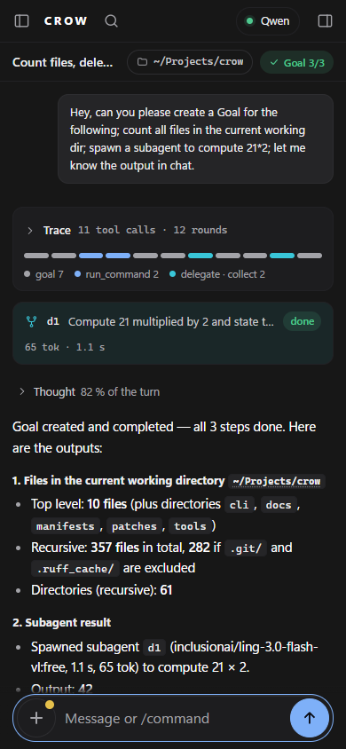

[← README](../../README.md) · [Docs index](../README.md)

# Phone (remote)

The window, mirrored to a paired phone: same session, same chat, send / stop / approve from the
phone. (#249).

## Start and pair

| step | |
|---|---|
| 1 | `/remote` in the window, or the phone icon in the title bar. Starts the mirror and opens the Remote dialog |
| 2 | Network: pick the address the phone can reach (LAN, or **HTTPS · Tailscale**) |
| 3 | Scan the QR with the phone's camera, open the link |
| 4 | Desktop: **Allow** in the bar (60 s, else denied) |
| 5 | Optional: Safari → Share → **Add to Home Screen** |

## On the phone (#387)

<div align="center">

</div>

Below 700 px the phone shows the window's own page, redesigned with it (#380), in phone form. The
picture is rendered by `tools/render_window.py --remote` (#381) in headless Chrome, dark, from
`tools/fixtures/goal-run-2026-09-16.json`, not taken on a phone.

| | |
|---|---|
| header | 48 px: rail toggle, CROW, the search magnifier (the field opens across the header, the [search](window.md) results under it), the model chip (short name; a tap adds the decode rate and the context), the inspector toggle. The git, browser, phone and window buttons are not shown |
| chat head | one 44 px row: title, folder chip, branch, and the goal pill, which is the phone's goal strip: a tap opens the inspector on its Goal tab. The old goal bar is gone |
| inspector | the right drawer (a swipe from the right edge opens it too) with the tabs Goal, Tools, Subtasks and Git. Git is a tab, no longer a drawer of its own; there is no Browser tab, a phone has no live page |
| turn | the trace strip full width, each segment with a 20 px tap band; the subtask card without the model; the telemetry strip as a 3-column grid |
| composer | one row, `+`, the input and the round send; the `+` sheet keeps its rows, and on the start screen, which has no chat head, its middle row holds the folder chip. The layout also follows a width change after the page has loaded, as on rotating the phone |
| start screen | mark 120 px, greeting 20 px, then the composer and the Continue cards, stacked |
| rail | the left drawer; Settings at its foot is a 44 px row |
| measured | 2026-10-14, 390×844, goal-run fixture: `scrollWidth` 390 (no sideways scroll) in the chat, the open drawer, the open search, the start screen and the light theme; header targets 44×44, the model chip 84×44; drawer tabs Goal, Tools 11, Subtasks 1, Git, each 44 px high, Goal showing 3 steps; telemetry 3 × 120 px, `scrollWidth` 360 = `clientWidth` 360; start screen with 2 cards |
| not checked | on a phone: the look against the desktop, whether the magnifier focuses the field on iOS (the field is 0 px wide until it has the focus), dictation and image upload with the new layout, the switch on rotation |

## Commands

| command | |
|---|---|
| `/remote` · `/remote on` | start, show the dialog with a fresh code (120 s, single use) |
| `/remote off` | stop; paired devices stay paired |
| `/remote status` | on/off, address, devices, firewall line |
| `/remote devices` | paired devices, last seen |
| `/remote forget <name>` | revoke one device: its stream ends, its cookie is refused |

## Addresses

| address | reach | phone 🎤 | set up |
|---|---|---|---|
| `http://<LAN IP>:8765/` | same Wi-Fi only | keyboard dictation only (no HTTPS) | none; firewall line in the dialog |
| `https://<pc>.<tailnet>.ts.net/` | anywhere, Tailscale on | records, Whisper on the PC | [Tailscale setup](remote-tailscale.md); `bash install.sh --tailscale` / `install.ps1 -Tailscale` print the missing steps |

- Each address is its own origin: a phone paired on one pairs once more on the other.
- The mirror listens on the chosen LAN address, plus `127.0.0.1:<port>` while Tailscale is up (the
  `tailscale serve` target). Never `0.0.0.0`, never the `100.x` address in plain HTTP.

## Phone microphone (#290)

| page | 🎤 |
|---|---|
| HTTPS address | tap = record: the 🎤 becomes a ■ stop button with a level ring, hint `listening …`. Every 1.5 s the words so far appear greyed in **this phone's** input field (Whisper on the PC, `faster-whisper small`, CPU). Stop = tap ■ or ~2 s of silence after you spoke; `writing …` until the final text replaces the grey. Each dictation is **appended** to what is already in the field (typed or dictated, one space between), so tap, talk, tap, talk builds one message. Nothing is sent until you send. First use: `loading the speech model …` (~52 s if it still has to download) |
| plain HTTP | focuses the input: use the keyboard's own 🎤 (iOS: Settings → General → Keyboard → Enable Dictation) |

Needs the voice extra on the PC:

```bash
bash install.sh --voice          # faster-whisper (+ PyAV, its decoder) and sounddevice
```

Without it the phone shows `dictation needs faster-whisper -- pip install faster-whisper`.

Unlike the desktop 🎤, the phone's recording reaches the PC as a file: each clip (partial and final) is written to the
window's upload folder as `remote-voice-*`, transcribed, and deleted either way.

Each dictation is one `crow.log` line: `[voice] phone dictation: <bytes> bytes, <s> s, transcribe <ms> ms[, error]`.

| clip (CPU, `small` int8) | 5 s | 10 s | 15 s |
|---|---|---|---|
| transcribe | 1.25–1.4 s | 1.4 s | 1.5 s |

## Security

| guard | |
|---|---|
| pairing | single-use 120 s code in the QR fragment + desktop Allow/Deny; 5 failures lock pairing for 10 min |
| cookie | `HttpOnly; SameSite=Strict`, 400 days, `Secure` on the HTTPS origin; only its sha256 is stored (`secrets.json` → `remote_devices`) |
| every request | Host → 421, Origin → 403, cookie → 401 |
| loopback listener | only Host `<pc>.<tailnet>.ts.net` and Origin `https://<pc>.<tailnet>.ts.net`; a bare `127.0.0.1` Host is 421 |

## Settings

`remote_enabled`, `remote_port`, `remote_host`, `remote_https` — see [Settings](../reference/settings.md).

## Troubleshooting

| symptom | fix |
|---|---|
| phone cannot load the LAN address | same Wi-Fi? run the firewall line the dialog shows (e.g. `sudo ufw allow from 192.168.2.0/24 to any port 8765 proto tcp`) |
| the LAN IP changed (DHCP) | the dialog lists the new address; the phone pairs once more. A DHCP reservation in the router keeps it fixed |
| "this phone is not paired" | `/remote` on the desktop, scan the new QR |
| HTTPS address | [Tailscale troubleshooting](remote-tailscale.md#8-troubleshooting) |
