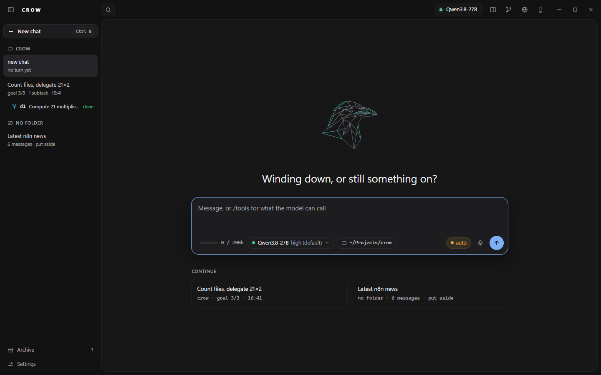
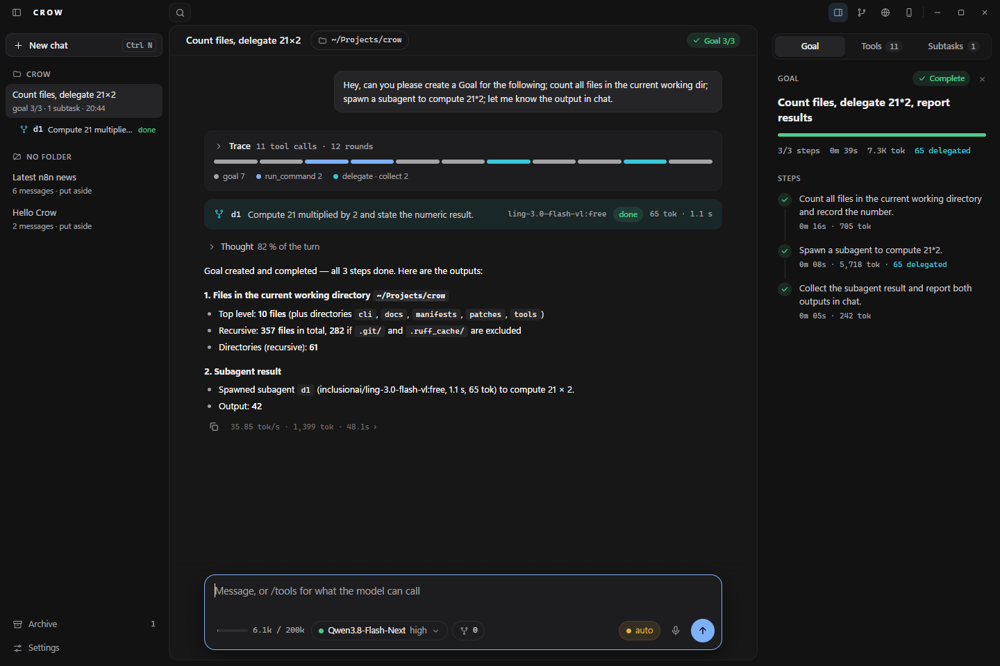

[← README](../../README.md) · [Docs index](../README.md)

# Window

Both pictures are rendered by `tools/render_window.py` (#381) in headless Chrome, dark, from `tools/fixtures/new-chat-2026-10-14.json` (with the name taken out of its greeting, as the window greets without one) at 1440×900 and `tools/fixtures/goal-run-2026-09-16.json` at 1440×960, not taken from a live window.

| | |
|---|---|
| Title bar | 36 px since 2026-10-18 (46 before), its buttons 28 px with 14 px icons, a toggle that is on shown by its colour alone; the phone keeps 32 px buttons with their tile. In three zones over the three columns and as wide as they are (#382): over the rail the rail toggle and the CROW wordmark (with the rail shut only the toggle, and the chat panel starts at 50 px); over the chat panel the search on its left edge; over the inspector, in this order, the inspector toggle, git (a branch), browser (a globe), phone, and the window buttons, all stroke icons. The Help menu is gone: Settings, its only entry, is a button at the foot of the rail. Rendered 2026-10-14 (headless Chrome, goal-run fixture, dark): the search's left edge and the chip's right edge on the panel's edges, 0 px off at 1180, 1440, 1920 and 2560 px wide, rail open and shut |
| Search | a 28 px magnifier until asked: a click on it, Tab or Ctrl+K (from anywhere, the composer included) opens the field to about 300 px, and it stays open while it holds text. Under it, at most 8 rows: **Chats** whose title or folder name contains the query (case-insensitive), in the rail's order, archived ones after them and marked; **Commands**, the composer's slash commands, the names that start with the query first. Up/Down move, Enter opens the chat or puts the command into the composer, Escape closes the list, clears the query and folds the field. Pressing and dragging in the field selects text and does not move the window (pywebview 6.2.1 starts a window drag for any press in the title bar). Messages are not searched; that is the model's [`session_search`](session-search.md) (#386). Rendered 2026-10-14 (goal-run fixture, 1440×960): `count` lists "Count files, delegate 21×2" first, `/go` lists `/goal`, `/del` + Enter leaves `/delegate` in the composer, Escape folds the field 300.9 → 32 px |
| Panel | the chat column is a panel with 14 px corners, a hairline border and 8 px of the rail's colour to its right and below; no lines separate title bar, rail and inspector, and the drag grips are still there, invisible. Colours from the mockup in all three themes; the light theme's accent is darker (`#2b67c9`) for contrast. Mono text is Google Sans Code from `cli/fonts`, which the page fetches after it has loaded (`Api.mono_font`): the page is 972,242 B as WebView2 counts it (UTF-16, limit 2 MB), against 1,684,958 B with the font inlined. Width transitions are off under `prefers-reduced-motion` (#382) |
| Rail | **New chat** at the top, Ctrl+N from anywhere does the same; the chats grouped under their folders (folder icon, upper-case name) and, once there is a project, the rest under **No folder**; fold state remembered. Each row is a title and a second line: `goal 3/3 · 1 subtask · 16:41` for a chat with a goal, else what it said before. The open chat stands on a raised ground, with no accent bar. A subtask hangs under its chat as a row with a fork, its id, its task and its state (`done`, `running`, `failed`). At the foot **Archive** with its count, and **Settings** (#385) |
| Chat head | over the conversation: the chat's title, the folder chip (the working directory and its menu, moved here from the composer row), the branch of that folder's repository (hidden without one), and a `Goal 3/3` pill that opens the Goal tab. The pill and the rail row of the chat in view show the folder's goal (`goal.json` belongs to the folder); other rows show what their own goal tools last returned. Hidden on an empty chat (#385) |
| Start screen | an empty chat: the mark (200 px), the greeting (26 px), the composer centred under them with the folder chip in its row, then **Continue** with up to two cards of the newest other chats (`crow · goal 3/3 · 16:41`, `no folder · 6 messages · put aside`), each opening its chat; with no other chat there is no such section. The first line you send puts the composer back at the bottom. Rendered 2026-10-14 (new-chat fixture, 1440×900): the group's centre 469.0 px = the panel's centre, the composer's top 26.0 px under the greeting. It pads 40 px top and bottom, not the mockup's 40/64, which puts the group 12 px above centre (#385) |
| Dashboard | on the first start of each day (a day starts at 04:00, so a turn at 01:30 still counts for the day before) the window comes up on an empty chat with the dashboard under the greeting and above the composer; the chat that would have been restored stays in the rail. It shows an activity grid of the last 12 months (53 weeks, Monday on top, month labels, `Mon`/`Wed`/`Fri`; one square per day, shaded by that day's tokens in four steps cut at the quartiles of your own days with any use, empty for none; a tooltip names the day and its tokens, and the hovered day is also written out under the grid), the tokens of the last 12 months, three figures (tokens in the last 30 days, the current streak with the longest, the active days) and the table **Models, last 30 days**: Model, Days, Tokens and Share of tokens as a bar and a percentage, largest first. Tokens are input plus output of each finished turn, counted for the day the turn ended and for the model that served it. The first message you send removes it, as it does the greeting; showing it is recorded (`dashboard_seen`), so a second start the same day comes up as before. It is also the first page of Settings, with the switch "Show the dashboard on the first start of each day" (`dashboard_daily`, on by default), which is where to switch it off. The figures come from the ledger `usage.jsonl`, written locally, one line per finished turn; nothing leaves the machine, and the history starts with this build, older chats are not counted. In this view the mark and the **Continue** cards are left out. The phone's Settings show the same page. Keys and the line format: [Settings › Dashboard](../reference/settings.md#dashboard-406). Rendered 2026-10-18 with `tools/render_window.py` from the sample fixture `cli/fixtures/dashboard-2026-10-18.json` (1440×960 dark, light and crow; phone 390×844); not checked live yet (#406) |
| Composer | one row under the input: the context meter (a 44 px bar and `6.1k / 200k`), the model and reasoning level as one chip with its menu, its dot the server's state (green: up, red: down, amber: connecting; with no model known the chip says `connecting` or `no server`; #391 moved this here from the title-bar chip it removed). On a local model Crow asks the server's `/health` every 5 s outside a turn, so a stopped point turns the dot red without a line being sent and a restarted one turns it green again; on the Claude subscription and OpenRouter the local server is not asked, the subtask chip (a fork and the count, once anything was delegated), the release level (`auto` on a warn tint; the other levels keep their colours), dictation, and a round send button whose Stop and Queue states are unchanged. 16 px corners, an accent border on focus, 14.5 px text (#385). The working directory is in the chat head |
| Copy | one button under each answer, with the folded telemetry line beside it: it copies that turn's answer, prose and code, through the path the right-click `Copy` uses, for live and replayed turns alike. There is no head line over a turn: the model is in the composer's chip (#383, #391) |
| Trace | the strip above the answer (#383). Its head, `Trace · 11 tool calls · 12 rounds` (was `Trace · N rounds`), is a disclosure that still folds the earlier rounds. Under it a 6 px bar with one segment per tool call in order — goal tools grey, `delegate`/`collect`/`subtasks`/`verify` in the subtask colour, every other tool in the accent, a failed call red — and a legend (`goal 7 · run_command 2 · delegate · collect 2`). A click on a segment opens that call in the Tools tab, the inspector too when it is shut. Shown once the turn has a call or a folded round. Rendered (goal-run fixture): 11 segments, 7 goal, 2 other, 2 delegation |
| Subtask in the flow | where `delegate` was called, a one-line card: fork, id, task, model (hidden under 760 px), status and `tok · s`, redrawn as the subtask runs; a click opens it in the Subtasks tab, which holds the full card. This reverses #255's "never a block of the chat" for that one line (#383). Rendered: d1 `done`, `65 tok · 1.1 s` |
| Thought | folded, one per re-entry: a chevron, `Thought`, and the turn's thinking share (`82 % of the turn`), with no border bar (#383) |
| Telemetry strip | folded since 2026-10-18: under each answer one faint line beside the copy button with the decode rate, the decoded tokens and the wait (`35.85 tok/s · 1,399 tok · 48.1s ›` in the goal-run render), and a click on it unfolds the strip under that row. The strip, in place of the bracketed cost line that scrolled sideways (#383): labelled cells that wrap — **Decode** rate and tokens, **Prefill** rate and tokens, **Cache** share and `cached / of`, **Rounds** and the tool calls (`, N failed`, `, N declined`), **Waited** (split into model and tools from 0.5 s of tool time), and **Delegated** (subtasks and their tokens) when the turn delegated. The numbers are formatted as the core's `TurnCost.line()` does; a cut-off turn adds the core's note in a line under the strip. A cell never breaks inside itself. Rendered 2026-10-14 (goal-run fixture, 340 px inspector): six cells in one row at 1440×960 (744 of 744 px), four plus two at 1180×800 (484 of 484 px), no horizontal scroll. A turn redrawn from a saved chat shows no strip; the replay carries no numbers |
| Answers | headings, lists, tables, bold, italic, inline code and links, drawn when the turn ends. Prose 13 px, the size of the user's bubble; headings 15 / 14 / 13 px, inline code as a small chip (#383) |
| Links and paths | http(s) URLs and file paths (POSIX and Windows, with `:line` or `:line:col`) are marked in answers, inline code and tool results. A click on a link opens it as a new tab in the inspector's Browser tab (#384). `_` inside a word or a URL is no longer emphasis (CommonMark 6.2) (#229) |
| Selecting and copying | content text selects and copies; controls do not. WebKitGTK 2.52 ignores the unprefixed `user-select`, and pywebview's `text_select=False` had injected `body{-webkit-user-select:none}`, so on Linux nothing could be selected before #228. Ctrl+C copies the selection (also through Python's clipboard path); on a focused link or path with nothing selected it copies the target |
| Right-click on content | a menu built from what is under the pointer: `Copy` (a selection), `Open in Crow's browser` / `Open in system browser` / `Copy link` (a link), `Copy path`, `Copy path:line[:col]`, `Show in file manager`, and for an `.html`/`.htm`/`.svg` path `Open in Crow's browser` (a path). Never "open with the default program". Up/Down/Home/End move, Escape closes (#228, #229). The rail keeps its own menu |
| Phone | the phone icon in the title bar (after the globe), or `/remote`: the window mirrored to a paired phone, on the LAN or over HTTPS via Tailscale (#249, #290) — see [Phone](remote.md); the redesign in phone form is described there (#387) |
| Inspector | one column right of the chat, opened and closed by the panel icon in the title bar (#384). Tabs **Goal**, **Tools** `n`, **Subtasks** `n`, plus **Git** and **Browser** while their title-bar toggles are on; Left/Right (wrapping), Home and End move between them (WAI-ARIA tabs). A new goal selects Goal, and a chat's first tool call without a goal selects Tools, unless you picked a tab in that chat. Dragged between 260 and 612 px; with the browser on, up to the window width minus the rail and the chat's 560 px. A fresh install starts at 340 px, the mockup's width (the owner, 2026-10-14); a dragged width is kept and read back up to the 4,096 px it may be stored with, so a width past 612 survives a restart (#388; it came back as 260 before). Squeezed under 150 px it hides its contents instead of showing a clipped sliver. It replaces the goal, subtasks and git cards pinned over the chat (#164, #255, #156) and the code panel beside them (#138), and with the cards the column reserve of #233/#256: nothing lies over the chat. Rendered 2026-10-14 (goal-run fixture, 1440×960): the chat head ends at x=1170, the inspector starts at x=1180, 0 px overlap between the text column and the inspector |
| Goal tab | `Goal` and a status pill (`Complete`, `Paused · step N`, `Open`, with `· step 4 skipped` when you skipped one) and the `×` that closes the goal; the title, a progress bar, `3/3 steps · 0m 39s · 7.3K tok · 65 delegated`, then the steps as a timeline — a check on green for done, an accent ring for running, a red pause for the paused step, a dashed ring and the word for a skipped one — each with its clock and tokens (#384). Without a goal the tab says `No goal in this chat.` It survives a rollover and a restart — see [goals and subagents](goals-and-subagents.md) (#161–#165). Goal mode stops itself and writes a note into the flow when a step has taken 25 turns, when the whole goal has taken 60, or when three identical or empty answers say the model is looping — the looping turns leave the history and one recovery line goes out in their place (#202); how many messages left is written to `crow.log`, not the flow (see *Crow log*). A `done` whose own note says it is not done is refused, and a user's `check:` command must pass before the goal closes (#250) |
| Tools tab | every tool call of the chat, one 32 px row each: a two-digit number, the dot of its kind (as in the trace strip), the name, a summary — the first argument's value (command, path, query), a `goal_step` as `step 3 · done` — and a chevron. Open a call for its `arguments` and, under them, its `result` — 4,000 characters, the remainder counted. A failed call is marked on its row. The numbers count the chat's calls, so after a `clear` an older trace segment finds no row instead of a wrong one (#384) |
| Program code | under the calls, from `write_file` and `edit_file` only. Its own fold with a count. The head of each block is the **path**, the body the content — no JSON envelope. Readable while it is being written; the envelope is replaced once the arguments are whole |
| `copy` per block | in the head of every code block, beside the path — it copies **that** block. The Tools tab's head has no `copy`: one button for calls and source together copied both to whoever wanted one of them (#156) |
| Chat column | chat and composer are one column: your messages stand on the right, their bubble's right edge on the input box's right border; Crow's answers, thoughts and notes start on the box's left border, with no mark column in front (#280). Column and box are computed from the same CSS variables (`--colw` 900 px, `--colpad`, `--sbw`), so they cannot drift apart, and the column centres in the chat panel: the reserve it kept beside the pinned cards (`--reserve`, #233, #256) went with the cards (#384). Measured 2026-09-24 on the layout before the redesign (headless Chromium, rail open/shut × 1180/1440/1920/2560 × 900 × no card/git/goal/subtasks, 32): short bubble right edge 716–780 px left of the box's right edge and answer text 40 px right of its left edge before #280, 0.0 px in all 32 after. Rendered 2026-10-14 on the redesign (headless Chrome, goal-run fixture, 1440×960): bubble right 1120 = box right 1120, answer left 294 = box left 294, and 1075 = 1075, 600 = 600 with the inspector shut (#385). The rounds inside an opened Trace keep their indent. WebKitGTK not measured |
| Subtasks tab | one card per subtask of this chat: fork, id, status pill, time and tokens, the task, the model, RESULT. The head reads `N running · M finished`, running cards on top. A chat switch drops the other chat's cards. A subtask is also a one-line card in the flow where it was delegated and a row under its root chat in the rail; a click on either opens this tab with the card in view, and a subtask is never opened as a chat. The `×` in the head hides the cards for this chat — running subtasks keep running, their rail rows and the composer's subtask chip stay — until a new subtask starts in that chat or a jump goes to a card; the mark is kept in the registry, so it survives a restart (#255, #281, #384). Cards keep breathing outside a turn, and Stop cancels the subtasks with the turn |
| Git tab | a tab of the inspector while the branch icon in the title bar is on; the icon also closes it, and the inspector returns to the tab before (#156, #384). See [Git tab](#git-tab-156-384) below |
| Browser tab | the globe in the title bar adds it to the inspector and selects it; switching the globe off removes it and returns to the tab before. Tabs, an address bar, per-tab history. Not an iframe. On Linux it is a second WebKitWebView inside the window (#201). On Windows it is a second frameless WebView2 over the tab's rect. The page shows only while the Browser tab is selected and the inspector is open; on any other tab it is hidden (`pane_hide`) and kept (#384). Folded, it holds no page, and a render does not unfold it; during a turn on the local model it renders without the GPU (#279). See [browser](browser.md) (#175) |
| `clear` | in the Tools tab's head: empties the calls and the program code, and both stay empty across a restart (#138, #384) |
| Code blocks | language, line count and `copy`. Fifteen lines or more can be folded away. A finished `write_file`/`edit_file` block keeps its `copy` button when its path is written into the head (#239) |
| Images | drop `.png .jpg .jpeg .gif .webp .bmp` into the window, paste a screenshot (Ctrl+V), or `/image <path>`: a chip per image above the input, `×` removes one. They ride the next line, appear in the transcript, and are still there after a restart. Needs a server started with `--mmproj` — one without it refuses with a sentence before anything is sent. The bytes travel unresized; the server caps an image at 4,096 tokens (`--image-max-tokens`). A dropped picture reaches Crow on every backend (#312, 2026-09-27): as its bytes when the drop carries files, else through the file manager's URIs, read from the GTK drag data (WebKitGTK hands a file-manager drop to the page with no files and an empty uri text); the chip keeps the file's name, and the phone mirror stages the same way. Any other dropped file keeps the old behaviour: its path lands in the input for the model to `read_file`. The model opens one itself with [`read_image`](../reference/tools.md) (#170). **Images Crow makes** (#308, #311): while an image tool runs (generate or edit), a tile in the image's aspect ratio stands in the chat with a flow animation drawn only from the theme's colours — a theme switch recolours it at once, reduced motion keeps it still — and the phase line (`sampling 12/40 · ETA 1:24`; an edit adds `stage 1/2`). An error turns the tile red with the reason; a stop reads `stopped — the server finishes it in the background`. The finished picture replaces the tile in place: a preview (long edge ≤ 512 px) captioned `name · W×H · size`. Only files inside the working area or under an approved outside path are shown; anything else gets a line saying why. A click or Enter opens the lightbox with the original pixels, fit to the window. Its bar: **Show in folder** (the file selected where the file manager offers FileManager1, e.g. Nautilus; else the folder), **i** (name, W×H, size in MB and bytes, format, created, path, tool, job/seed), Copy image, Copy path, Save as…, Open in viewer, **Move to trash** (two clicks; into the desktop's trash, never deleted), Close. Esc closes it and never stops a running turn. A reopened chat draws the preview again; a job that never got its picture shows `interrupted`, never a running animation, and a file that is gone says so. On the phone mirror the tile, the previews, the lightbox and **i** work; **Download** saves the file on the phone; the other actions run on the desktop. Windows (canvas previews, recycle bin, image clipboard) is not checked live yet |
| `/delegate` mid-turn | the delegation pair (`/delegate`, `/subtasks`) passes the Stop gate: typed while a turn runs, the card starts beside it, the turn keeps streaming, and the composer stays on Stop. The Stop button and Escape stop the turn (#143 E3) |
| Typing mid-turn | a plain line + Enter while a turn runs — goal mode included — is **queued**, not a stop: the turn keeps going, the hint reads `queued -- it goes in when this turn ends`, and at the turn's end the line is drawn and runs next, ahead of goal mode's own nudge; it resets the goal's turn caps like any typed line. Two lines queued go in as one message. **No typed line is a stop**: a line that opens with `/` but is not a Crow command (a path) is queued too; while the box holds a line the button reads `↑ Queue` and a click queues it; a Crow command other than the delegation pair (`/model`, `/goal`, `/reset` …) waits in the box until the turn ends and the hint says so. Stop is an empty Enter, the button with an empty box, or Escape (with anything in the box). An Enter that confirms an input-method composition is not a submit (#264, #165) |
| Stop in goal mode | Stop ends the turn **and pauses the goal**: no next turn starts, and the chat says `goal mode paused: you pressed Stop. Step N is open -- the next line you send resumes it.` The next line you send runs and the goal continues after it; a line queued before the Stop runs first (#282) |
| Stop during a tool | Stop while a `run_command` runs ends the command (SIGTERM, SIGKILL after 2 s, with everything this call started) and the turn within ~3 s; the remaining calls of the round do not run and no further request goes to the server. The model's next turn reads `error: stopped by the user after <N>s`. Background jobs started by **earlier** calls keep running (#310) |
| `/verify` | the conversation's own writes go to the checker spot with review instructions; the verdict comes back as a subtask card (#149) |
| OpenRouter page | its own pane in Settings, and it routes no turn: the switch parks or runs the broker — delegation, catalogue, favourites — while the machine keeps answering. The default is always the machine; turns leave it only through the Model page |
| Delegate favourites | on the OpenRouter page: three dropdowns over the whole catalogue, tried in your order before the free default — a paid favourite is your explicit pick on your own key, and what nobody chose never falls forward onto a bill. A spot that failed this session is skipped (#146, #148) |
| Budgets | `turn_token_budget` and `subtask_max_tokens` in settings.json, both opt-in (#145); a spent token budget ends the turn with the same protocol as the round budget |
| Self-healing | dies the server the window itself booted (`booted.json`, kept across restarts — `%LOCALAPPDATA%\Crow\` on Windows, `~/.local/state/crow/` on Linux), the turn reboots it — `booting it again (n/3)`, three per turn, then honestly red with the boot's own exit code. A server still loading (HTTP 503) is waited out once per turn |
| Crow log | Crow's own status lines about its machinery are written to `crow.log`, not into the chat (#262): the goal brake's `goal mode: N messages of an empty loop dropped from the history`, the same-failure line `goal mode, step N: the same failure keeps coming back -- …`, a discarded or kept degenerate round (#217), `the restored cache did not hold`, `the page in the browser panel stopped (…)` (#279), the chat-open and goal-setup bookkeeping (`working directory: …`, `mode yolo -- …`, `archived: …`, `no working directory -- writes are unbounded`, the working-area and goal cost notes, the `/goal` setup echo `goal: <title> -- N steps …`), the rollover's `rolled over at N tokens -> …` line, the working-area boundary alarm `! the working area was refused for …` with its explanation (#98), and — in the terminal — `tool budget spent after N rounds`. One line each, local time with its UTC offset and a kind: `2026-09-23T21:04:18+0200 [goal] goal mode: 52 messages …`. `~/.local/state/crow/log/crow.log` on Linux, `%LOCALAPPDATA%\Crow\log\crow.log` on Windows; rotated at 1 MiB, three old files kept (`crow.log.1`..`.3`). A reopened chat from an earlier build no longer draws these lines either. What stays in the chat: the rollover card, `goal mode stopped: …` / `goal mode paused: …`, the server reboot and load-wait lines, every other alarm, the `/goal` status answer (`goal: <title> -- 3/9, …`), `Memory updated`, `carried across the cut: …`, and every answer to something you typed or clicked. None of the moved lines was ever sent to the model; the nudges the model reads are unchanged |
| Boot logs | every boot Crow starts writes `llama-server-<port>.out.log` / `.err.log`, rewritten per boot — under `<cwd>\runs\` on Windows, `~/.local/state/crow/log/` on Linux. A silent death leaves its exit code and stderr there |
| Persistent subtasks | cards and rail rows come back after a window restart (`session/subtasks-registry.json`): `running` becomes `interrupted`, numbering continues, deleting a chat deletes its subtasks |
| Scroll | the stream pulls to the end only for who IS at the end (80 px); scrolled up, nothing yanks you back — your own message does |
| Scrollbars | shown only while a strip scrolls (wheel, keys, touch, drag; gone 0.8 s after the last movement, kept while the pointer is held) or while the mouse pointer is over it — the chat, code blocks, tables, the inspector, the rail, menus. At rest nothing is drawn, and nothing moves when a bar appears: the space stays reserved. The phone mirror uses the same page without the hover part; iOS draws its own indicator while you swipe (#305). The browser tabs strip and the phone's image and settings-category strips scroll without any bar |
| Layout at the minimum size | the composer's buttons stay inside the input box, long paths, URLs and compounds wrap inside the column instead of widening it, a squeezed inspector hides its contents instead of showing a clipped sliver, and the settings sheet stays under the title bar (#231–#235). Audited 2026-09-23, on the layout before the redesign (#380) (headless Chromium 1234 and WebKitGTK 2.52, 1130×520 to 2560×1440): composer spill and cut 477 → 0 findings, long-word overflow 1,950 → 0; re-audited on the integrated tree over 185 Chromium and 12 WebKitGTK renders. Accepted by the owner in the live run of 2026-09-23. The redesign is not audited at 1130×520 yet |
| Long chats | the rail and panel drags and the window resize follow the pointer. Measured 2026-09-23 on a 200-turn chat (12,968 nodes), WebKitGTK 2.52.6: rail drag 38.8 → 3.6 ms per step, window resize 16.9 → 4.0 ms, and 0 px of view drift after a mid-chat drag (was 2,079 px; WebKitGTK has no scroll anchoring) (#236–#238). On Windows the bridge calls are coalesced instead of dropped; not measured there |
| Working area moved | when the chat's folder changes, the model is told once, before your next line: `[Working area is now X (was Y).]` (#224). The notice rides that request only; a reopened chat draws your typed line alone in the bubble, not the notice (#241) |
| Start with `--root` | `crow --root DIR` binds DIR for the window and for the chat it restores, and makes DIR the folder the next start without `--root` opens (`active` in `roots.json`), the same as picking it in the chip. Before #303 the restored chat fell back to the last folder picked in the chip. A chat that recorded another folder is moved to DIR: the model is told once (#224), and its memory head is rebuilt only if it named the other folder. Without `--root` a restored chat keeps its own folder, or else the last picked one (#101). Covered by tests; not yet run live |
| Closing | Crow's X (or the compositor's close) ends the process: pywebview's bridge threads are daemon threads, so an answer still in flight at the close cannot hold the exit (#313). If anything else still holds it 5 s after the window is gone, the exit watchdog writes an `[exit]` line naming the remaining threads plus their stacks to `crow.log`, stops the MCP servers and ends the process (#313, 2026-09-27: after the X the process could stay and a terminal needed Ctrl+C). The close first saves the chat and the KV cache (seconds with a large cache) and says `saving the chat and the cache...` meanwhile; the watchdog waits for a running save up to 30 s, and `session.json` is replaced whole, never cut (#325). On Windows the close also ends the browser panel's own window and arms the watchdog itself, so a used panel no longer keeps the process alive (#328) |
| Reload | a reload of the page (the recovery after a dead WebKitWebProcess, #204) redraws the live chat and runs start-up only once: it no longer restores session.json into a running chat and closes the window (#209). Covered by tests; not run live in WebKit |
| Tool-result clearing | before the window has to roll, old tool output is let go (#263). At 0.65 of the window (default on the local server, off for a remote provider), every tool result older than the last 5 rounds becomes one line: `[cleared at N of M tokens to keep the window: read_file 'path' -- chars, ~tokens. The file is on disk: read it again if you need it. Original: …/session/cleared/<stamp>.json]` (the path is quoted in backticks in the real line). In the same batch the bodies the model wrote itself go too (#359): the `content` of `write_file` and `append_file` and the `old` and `new` of `edit_file`, 600 chars or more, each become `[cleared at N of M tokens: write_file 'content' for 'path', chars. Read the file if you need it; it may have changed since. Original: …]` (a call whose result was an error says `The call failed: this text never reached the file.` instead); the argument names and the path stay. A file whose body was cleared counts as unread again, so the next `write_file` or `edit_file` on it reads first (#215-H), and `/verify` reads cleared bodies back from the originals file. Every stub of either kind starts with `[cleared at `: that is the string to grep a work tree for. Your lines, the model's answers, its reasoning and the rest of its tool calls stay exactly as they were, and so do the head (memory, goal) and the last 5 rounds. A batch runs only when it frees at least a tenth of the window, because every batch makes the server re-read the conversation from the first cleared message on (on the diorama replay: 64k to 95k tokens per batch); the bodies ride in that batch and add no second re-read. Goal state, memory, skill and subtask results are never cleared. Nothing appears in the chat; each batch writes one line to `~/.local/state/crow/log/crow.log` (`[context] context-clear: … tool results and … call bodies …`, #262's log). `context_clear_at` in settings.json sets the share, `0` switches it off; `context_clear_inputs` `0` keeps the bodies. The rollover below stays as the last resort: replayed on the 2026-09-23 run, each rollover came 55 and 88 rounds later, and neither recorded context would have reached it on its own |
| Rollover | past 0.9 of the window the next line rolls BEFORE the turn — the archive is a complete conversation, your line opens the new context as carry. Mid-turn the roll happens at a round boundary, once per turn; a refused second roll is a red line, and the readout resets the moment a roll happens (#152). The note carries the model's own digest of the leg — asked on the still-warm prefix, marked as unverified model text, capped by `rollover_digest_tokens` with a floor of 2000 tokens (`0` off, #154/#205). The leg speaks the turn's own reasoning fields so it lands on the warm cache, and thinking that leaks into the answer is washed out afterwards (#205 replaced #157's thinking-off switch, which re-rendered the prefix cold). An answer that is a tool call is asked once more; one that still is not text, or is under 200 characters, becomes the line `[digest failed: ...]` (#210). An answer the cap cut off loses its unfinished last line and ends with `[digest cut off at the N-token cap ...]` (#210). The head after the cut carries the goal's step marks once — `[done]`/`[running]`/`[open]` and the next step (#210). Behind the note come the last 3 tool rounds from before the cut, verbatim: answered, successful and correctly named calls only, results clipped to 2000 chars and marked `[carried across the cut]`, images replaced by a sentence, 3000 tokens at most, an `edit_file`/`write_file` preferred. Your line comes after them. A reopened chat draws them as a note line `carried across the cut: <tools>` under the card, not as new tool rows (#214) |

---

## Dictation

The microphone sits between the release level and the arrow. While it records, the composer is a
live waveform:

| | |
|---|---|
| Why Python and not the page | the window is handed to WebView2 as HTML rather than served, so it is not a secure context — `getUserMedia` is behind that same gate, and WebView2 has no recogniser of its own |
| Model | `faster-whisper-small`, ~486 MB, multilingual. `install.ps1` fetches it on Windows; on Linux the window fetches it on the first click |
| Audio | 16 kHz mono asked of the device directly, no resampler behind it |
| Disk | nothing. `sounddevice` fills an array and `faster-whisper` takes it directly — there is no WAV in between |
| Optional | both imports are, like pywebview itself. Missing ones are **named** in the sentence the button answers with |
| Linux | `bash install.sh --voice`, plus PortAudio from the distribution — see [Linux](linux.md) |

It never submits by itself: the text lands in the input and you press the arrow.

The phone has its own 🎤 on the HTTPS address, transcribed by the same model on this PC — see [Phone](remote.md#phone-microphone-290) (#290).

---

## Git tab (#156, #384)

The branch icon in the title bar adds the Git tab to the inspector and selects it, and closes
it again — there is no cross in the tab, for the reason the inspector has none: a control inside
the thing it folds away leaves no way back.

| group | what it shows |
|---|---|
| Changes | branch against its upstream, every changed file with its status letter and `+`/`−`, the totals in the head. Untracked files are listed and counted separately — they are never swept into a commit |
| `⎇ <branch>` | the current branch, ahead/behind in the head, every local branch in the body |
| `⊸ Commit` | the tracked, changed files **by name**, a message field, and the button. It stages exactly those paths — no `-a`, no `.` |
| History | `◉` commit · `⑃` merge · `⇧` push · `⑂` fork · `◈` connect. Commits and merges come out of `git log`; pushes and connects out of Crow's own record (`git_events.json`, beside the sessions) — nothing is invented, a fork appears the day one happens |

The repository is the one the **working directory** is bound to, never the process's
cwd. No folder bound, or the folder is not a repository: the tab says so and shows
nothing else.

### Connecting GitHub

Settings → API Keys → GitHub. The client id belongs to an OAuth app **with device
flow enabled** and is not a secret — the device flow has none, which is why it may
be shipped or typed in plain. `Connect` puts a code in the chat; enter it at
github.com/login/device and the token is stored owner-only beside the provider keys
(`provider_keys.json`). One app covers every repository the account can reach.

`Disconnect` sits on that same page, and only there: the account button in the
tab's head **only connects**. As a toggle it once read a stale label and
disconnected the account somebody was trying to connect.

**Pushing uses git's own credentials**, not that token — a token on a git command
line would be readable in the process list for the length of the call.

---
